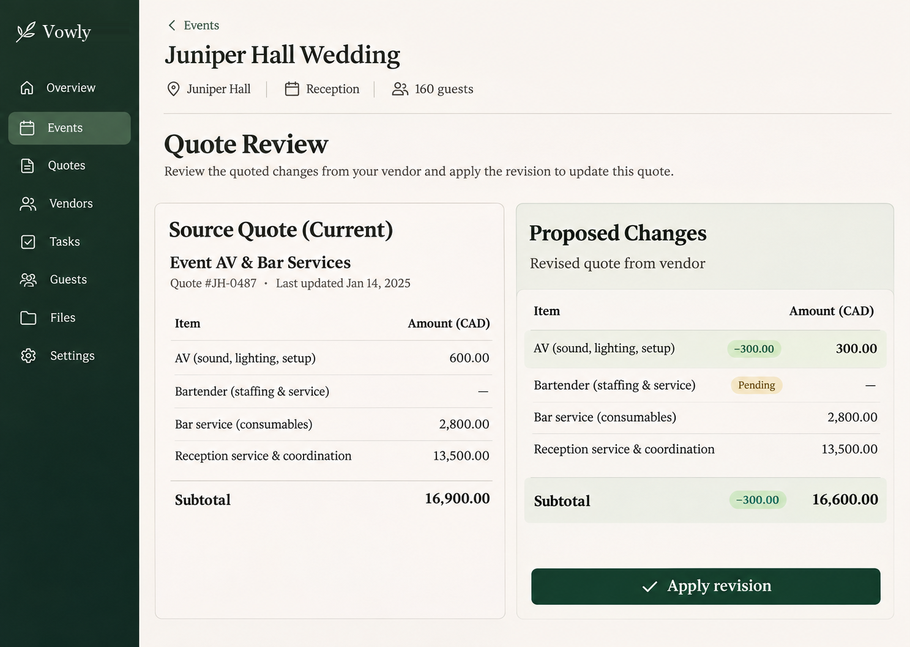
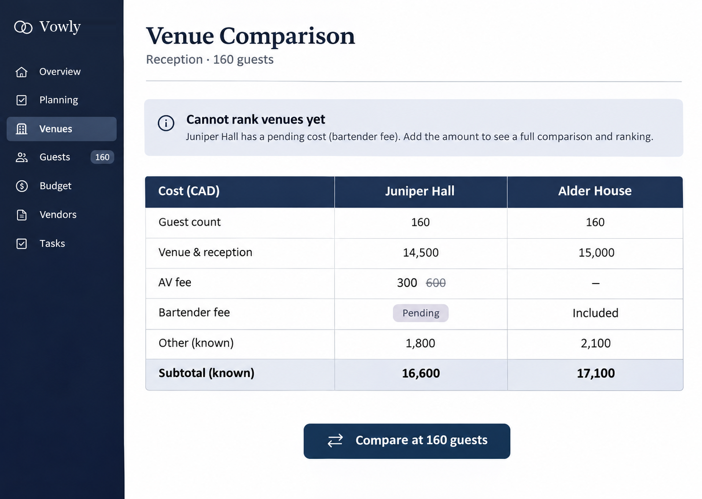
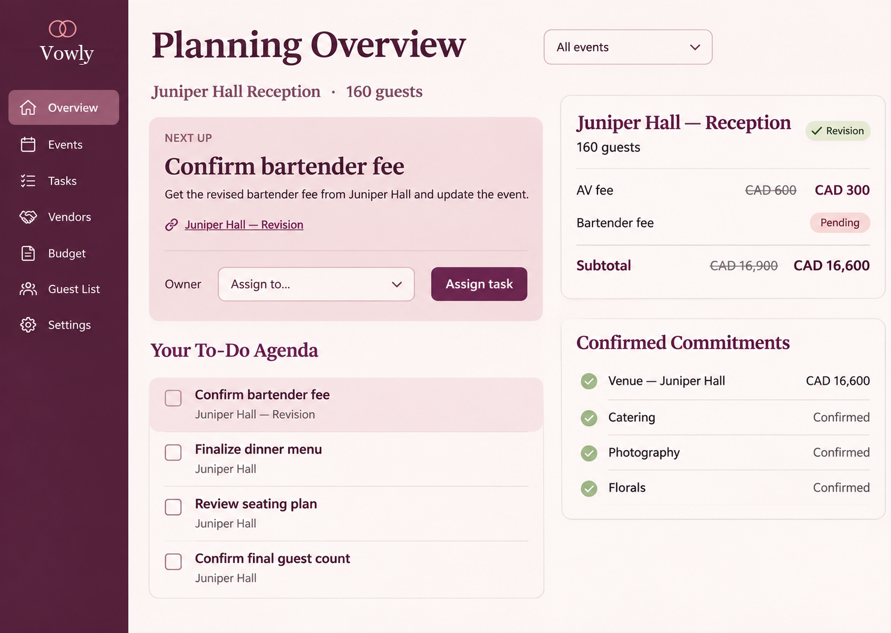

# Vowly | Product specification

Product requirements · v0.3 · November 2026 · Proposed pilot

## Decision this release should answer

Will a self-planning couple come back with their next vendor update after Vowly helps them compare their first two quotes? First-use value is a decision they can explain to each other. Repeat value is keeping that decision accurate when a price, headcount or deadline changes.

The first user is the partner who currently copies vendor replies into a spreadsheet. The second is the partner who wants to see why an option is worth the money without rereading ten conversations. A couple can start midway through planning with one event and a single pasted reply. Date, overall budget and a partner invitation can wait until needed.

## Design exploration

Three static prototype directions use a fictional reception for 160 guests. Each tests a different moment in the same journey. The calculations and acceptance rules below govern implementation where the mockups simplify or differ.

### Quote review | Can I trust the change?

Walk through reviewing a revision

The planner opens Juniper Hall and pastes a revised message. The AV fee falls from CAD 600 to 300. The known subtotal falls from 16,900 to 16,600. Bartender staffing is still open. Selecting a changed field should reveal the exact passage in the new message alongside the previous value. The planner can edit a misread amount, dismiss the suggestion or apply the revision. Applying records the source and refreshes the comparison. Booking remains a separate decision. A failed extraction retains the input and offers manual entry.

Test whether someone can explain the savings, identify the outstanding fee and distinguish approving a quote from committing to a venue. This is the first concept I would prototype because a trustworthy revision supplies the data for both other screens.

### Venue comparison | Which question could change our choice?

Walk through the spending decision

The couple selects two venues for the same event. At 160 guests the known subtotals differ by CAD 500. With all other items equal, a Juniper bartender fee above 500 reverses its apparent cost advantage. Show that break-even point and let the couple assign the follow-up. They can still prefer a venue for its location or food. Changing the hypothetical guest count recalculates eligible tiers without changing the saved event headcount. If capacity is exceeded, display the constraint beside the price.

Test whether the other partner can explain the tradeoff without reading the original thread. On a phone, keep the same comparison rows aligned and expose the source for each value on tap.

### Planning overview | Who is picking this up?

Walk through delegating the follow-up

The lead partner assigns “Confirm bartender fee” to a helper. The helper sees the vendor, question and relevant context. The couple sees the owner and whether an answer arrived. A reply can trigger a new proposed revision. Design correction before build: show the task once, moving it from suggested to assigned. Label the amount “known quoted subtotal” until the couple explicitly records a booking. Let the helper complete the task without giving access to the wedding budget.

Test whether each participant can tell who acts next and whether the venue is booked. Compare reminder usefulness with the extra effort of maintaining assignments.

## Scope decisions

| Priority | Deliverable | Rationale |
|---|---|---|
| Pilot essential | Event setup, shortlist, quote capture and review, comparable pricing, revisions, payment records and assigned follow-ups | One complete decision from first quote to next obligation |
| Pilot convenience | CSV import with column mapping and preview, budget export, reminders | Prioritize when onboarding or missed deadlines block real use |
| Later | Discovery marketplace, guest-facing schedules, coordinator handover, ceremonies and destination scenarios | Each needs different data, contributors or distribution |

Instagram and WhatsApp remain user-controlled sources. The pilot accepts a selected excerpt or screenshot. A vendor account, social login and background access to private conversations are unnecessary. Generic AI chat is optional. Visible controls cover the full pilot journey.

## Product rules engineers and designers can test

| Scenario | Expected behavior |
|---|---|
| A screenshot omits a fee or the currency is unclear | Preserve unknowns, ask one targeted clarification and show the known subtotal with its currency |
| A quote contains a minimum spend | Apply the floor only to items and attendance conditions specified by the venue. Ambiguous tier rules require review |
| A vendor agrees to a lower rate in chat but the signed document says otherwise | Show both sources and request reconciliation before changing the committed amount |
| A photographer charges hourly | Multiply hours by rate. Record team size and mini-shoot inclusion separately. Missing coverage stays unknown |
| A couple compares three alternatives | Track one selected forecast per category or booking need. Alternatives never add together as committed spend |
| A deposit is recorded twice or an extraction is retried | Match the existing transaction or request confirmation. Reprocessing the same input leaves the balance unchanged |
| An event changes after someone opens a review | Surface the newer value and require review against the current version before applying |
| A document gives a deadline relative to an unknown event date | Preserve the relative obligation and request the missing date before scheduling a reminder |

The model extracts facts and suggests questions. Application code calculates prices and balances from approved inputs. Store source, event coverage, revision history, booking status, payer-reported payment and linked tasks as distinct records. Use visible labels for missing fields and status changes alongside color. Permit keyboard review, correction and dismissal.

### Lifecycle states and access boundaries

- **Vendor status per event:** `Shortlisted` → `Quoted` → `Revision pending` → `Booked` or `Declined`. Approving a quote revision updates the forecast without changing booking status.
- **Task status:** `Suggested` → `Assigned` → `Answered` → `Closed`. A helper’s reported price creates a proposed revision for the couple to review rather than mutating the quote directly.
- **Pilot helper access:** Share a task-scoped link or view showing only the vendor name, question and relevant excerpt. Do not require a full workspace account or expose overall wedding budgets and payments.

## Pilot evaluation and release gates

Recruit five self-planning couples. Have each compare two equivalent vendor offers using their current method and the prototype, counterbalanced to reduce practice effects. Record time through a correct answer (including corrections), corrections required and missed terms. During a two-week pilot, count repeat use only among couples who actually receive another vendor update, payment or task—a quiet week provides little evidence about retention. Interview both partners where possible about who saved time and who picked up extra work.

**Proposed pilot decision gate (directional for a small sample):** Proceed if at least four of five couples independently identify the unresolved fee and assign the follow-up, and a majority of those receiving a second update choose to use Vowly again.

- If trust fails, improve source review first.
- If couples understand the result but prefer their spreadsheet, test exporting proposed updates.
- If they struggle primarily to obtain initial quotes, revisit vendor shortlisting.

**Offline extraction evaluation:** Hold back synthetic or consented, redacted examples from prompt development. Cover hourly photography with missing extras, tiered venue pricing, conflicting revisions, bundled multi-event contracts, duplicate screenshots, minimum-spend exceptions and relative deadlines. Score source support, exact amount and currency, arithmetic, correct unknowns, duplicate payments/tasks and task owner/date only when stated. Record human correction time, latency and inference cost per accepted revision. Publish only synthetic examples and measured results.

**Release blockers:** Treat invented charges, unsupported amounts without source passages, or double-counted bookings/payments as release blockers.

## Who we are building for

A self-planning couple makes decisions together even when one partner does most of the research. They need to know what they can afford, what each vendor actually agreed to, and who owns the next step. Family may help select a venue or menu. A friend helping on the day needs an assignment and an arrival time. A coordinator hired later needs the confirmed plan and guidance on which decisions to escalate. Guests need logistics and explanations of the couple's chosen traditions.

## What we learned

The founder's household already uses a spreadsheet, shared messages and AI summaries. Friends' referrals help establish trust. The work continues after discovery as couples request quotes, interpret different packages, negotiate, confirm bookings and update their plans. An hourly photography quote can omit the mini shoot included in a fixed package. A venue price can change with headcount, minimums and separately negotiated fees. An estimate, a signed agreement and a payment are three different facts.

These observations come from one household. The commercial opportunity, frequency of repeat use and willingness to pay remain open questions.

## First release

Help a couple take two real vendor offers from initial comparison through a booking, a payment and an assigned follow-up. Start with photographers and venues. The dashboard opens on upcoming obligations and changes awaiting review. Every core action works through visible controls.

1. Create a wedding workspace. Start with one event, allow custom names and optional dates, and add events as needed. Record event headcount, currency and budget. Switch between one event and the whole wedding.
2. Save vendors discovered anywhere with a portfolio link, referral and personal notes. Track status per event so a photographer can be booked for one and under consideration for another.
3. Paste a conversation or add a screenshot or quote. Show each proposed change beside its supporting text. Allow corrections, manual entry and approval. Preserve earlier offers and flag conflicting terms.
4. Compare packages using the couple's required coverage or guest count. Calculate from explicit prices, tiers, minimums and fees. Show unknown charges and capacity limits. Keep estimates distinct from agreed amounts. Help the couple identify a specific follow-up or prepare a counteroffer.
5. On booking, record events covered, agreed price, payment schedule and payments reported by the couple. Deduct deposits from the outstanding balance. Retain contingent amounts until the required inputs are known.
6. Turn explicit obligations into suggested tasks with the source and due date. Let either partner create, accept, edit, assign and complete a task. A helper receives the relevant details. Couples control financial changes and vendor communications.

## Multi-event acceptance examples

- One vendor has one contact record and a separate booking status for each event.
- One contract covering a ceremony and reception counts once in the overall budget. Proposed default: let couples allocate amounts across events or leave them marked shared. Event allocations plus the unallocated amount must equal the contract total.
- A whole-wedding task can stay at workspace level. An event-specific task appears in both its event view and the overall list as the same task.
- A couple planning one ceremony can compare quotes without setting up additional events or choosing a cultural template.

## Competitive rationale

[Coco](https://www.planwithcoco.com/) already advertises AI quote comparison, shared planning and payment tracking. [WedSites](https://wedsites.com/wedding-planning) covers collaborative tasks, contracts and timelines. [Paige](https://weddingpaige.com/) checks planners' vendor emails against their contracts. [Timeline Genius](https://www.timelinegenius.com/) provides stakeholder-specific schedules. [WeddingWire Canada](https://www.weddingwire.ca/my-wedding-planner) offers free planning tools, and [Zola](https://www.zola.com/wedding-budget) connects marketplace bookings to budgets.

Our hypothesis is that couples will return when an off-platform vendor sends a revision and they can quickly verify what changed, see its impact across events and assign the follow-up. The benchmark is their current spreadsheet and messaging workflow. Competitor observations reflect public descriptions.

## Sequencing and open decisions

Prototype the comparison and revision workflow first. Test with a second partner and a helper before expanding permissions. Test a simple spreadsheet import against real column layouts before committing to migration. Use synthetic examples in public demos and run the prototype locally to control costs.

### Pilot backlog

| Order | Workstream | Tracked issue |
|---|---|---|
| 1 | Offline extraction benchmark on labeled synthetic cases | [#2 Evaluate AI quote extraction against labeled examples](https://github.com/nimish-hegde/vowly/issues/2) |
| 2 | Quote revision review with source passages and idempotency | [#1 Review and apply a revised venue quote](https://github.com/nimish-hegde/vowly/issues/1) |
| 3 | Side-by-side venue comparison with break-even fee and headcount tiers | [#3 Compare two venues at the same guest count](https://github.com/nimish-hegde/vowly/issues/3) |
| 4 | Scoped follow-up assignment to a helper | [#4 Assign a follow-up from an unresolved vendor fee](https://github.com/nimish-hegde/vowly/issues/4) |
| 5 | Five-couple pilot study and go/no-go decision | [#5 Test the quote workflow with five self-planning couples](https://github.com/nimish-hegde/vowly/issues/5) |
| Gap | Booking confirmation, deposit tracking and hourly photographer quotes | Not yet filed — required for full "First release" scope |

Later opportunities include local-versus-destination feasibility, family guest-list consolidation, coordinator handover, tailored schedules and guest ceremony guidance. Revisit vendor discovery if pilot couples spend most of their effort obtaining initial prices. Test whether couples prefer event-level allocations, shared expenses or both.
